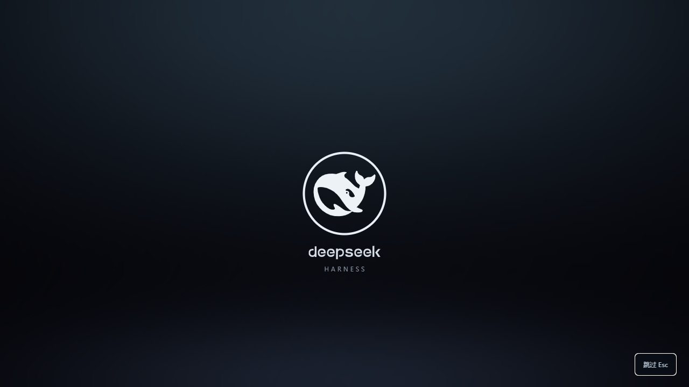
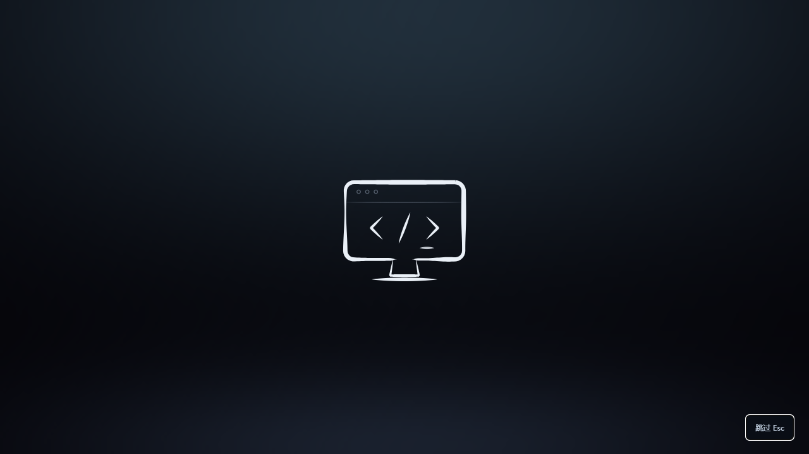

# DeepSeek Startup Animation

[简体中文](README.zh-CN.md)

A six-second startup sequence for DeepSeek Harness Desktop: a pressure-stroke terminal workstation draws itself, flows into a ring, and reveals the official DeepSeek whale and wordmark. Optional Steam Big Picture startup audio plays at its original speed in stereo.




## Install in Desktop

Requires DeepSeek Harness **0.2.1-rc.3 or later in the 0.2.x line**.

1. Download `dsh-startup-animation.tgz` from [Releases](https://github.com/bilbillm/dsh-startup-animation/releases/latest).
2. Open Desktop's **Plugins** page, choose **Add plugin**, and enter the local tarball path (or its release download URL).
3. Enable the plugin and reload the application when requested.

Install through Desktop's plugin manager so it targets Desktop's own profile. A separate `web` profile does not change the Desktop application.

For a regular web profile:

```sh
dsh plugin --profile web add https://github.com/bilbillm/dsh-startup-animation/releases/latest/download/dsh-startup-animation.tgz
```

Automatic playback is desktop-only by default; enable web playback on the plugin's page if wanted.

## Controls

Open the plugin's own detail page to enable startup playback, switch audio, set volume, allow web playback, or play a preview. Preferences are stored locally in the current application's browser storage and take effect at the next startup or preview.

- **Esc** or **Skip** dismisses the animation immediately.
- System **reduced motion** skips automatic playback.
- A browser that blocks automatic sound shows **Enable sound**. The animation continues and ends on time.
- Switching tasks or changing plugin configuration does not replay the opening. Reloading the application starts a new opening.
- The final background darkens with the whale, then reveals the running application. No mock application is included.

The plugin does not read conversation content or credentials, make network requests, modify host code, or add install-time scripts. Audio, artwork and light-field data are packaged in the client. Disabling/unloading it stops audio, cancels animation frames, removes observers/listeners, restores focus and releases the overlay.

## Development

The source checkout includes the prebuilt `lib/` files and needs no install-time compilation. Rebuild with Node.js 22+:

```sh
npm run check
npm pack
```

`tests/browser.cjs` additionally exercises the real Canvas renderer and browser lifecycle through Playwright. `scripts/build.mjs` uses only Node built-ins; React and Cordis slots come from the running host. The plugin registers `plugins.bundle.config` through the public slots API.

## Credits and license

Plugin code is MIT licensed. DeepSeek branding and Valve's Steam startup audio remain their owners' material and are excluded from the code license. See [third-party notices](THIRD_PARTY_NOTICES.md).

This is an independent community plugin, unaffiliated with DeepSeek or Valve.
